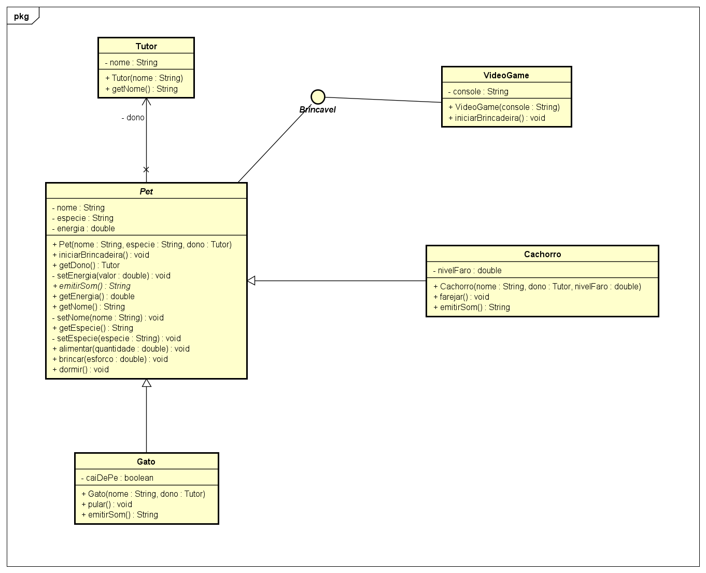

# Projeto FiapRide - Julia Yamazaki

## Informações do aluno

- **Nome:** Julia Yamazaki
- **RM:** 568438
- **Turma:** 2CCPS
- **Curso:** Ciência da Computação
- **GitHub:** [@juiyya](https://github.com/juiyya)

---

## Descrição do projeto

Este repositório documenta minha evolução nas aulas 1 a 9 de Programação Orientada a Objetos (POO). O projeto principal, **FiapRide**, simula partes de um aplicativo de mobilidade: cadastro de passageiros, carteira com saldo, veículos e viagens. Ao longo das aulas, foram adicionados encapsulamento, construtores, associação, herança, polimorfismo, abstração e interfaces.

Em paralelo, desenvolvi o **MiniKita**, um projeto pessoal de pet virtual. Nele, cada pet possui nome, espécie e energia; é possível alimentar, brincar e dormir. Depois, o projeto evoluiu para incluir tutor, tipos de pet e diferentes objetos que compartilham a capacidade de brincar.

O repositório também contém os materiais dos **Checkpoints 1 e 2**, os exercícios iniciais em **aula 2** e os diagramas usados durante a evolução.

### Checklist de implementação

- [x] **Aula 1** — Classes e objetos
- [x] **Aula 2** — Métodos 
- [x] **Aula 3** — Encapsulamento 
- [x] **Aula 4** — Construtores
- [x] **Aula 5** — Associação
- [x] **Aula 6** — Herança 
- [x] **Aula 7** — Polimorfismo
- [x] **Aula 8** — Classes abstratas 
- [x] **Aula 9** — Interfaces

## Perguntas de reflexão

### Aula 1 — Classes e objetos

**Por que precisamos criar uma classe Passageiro? Não seria mais fácil apenas criar variáveis soltas no main, como String nomeAna = "Ana" e double saldoAna = 50.0?**

_Pense: E se o FiapRide tiver 1 milhão de usuários? Como a Classe ajuda a resolver isso?_

**Resposta:**
Uma classe reúne os dados e as ações de cada passageiro, sem espalhar variáveis no main.
Cada objeto Passageiro tem nome e saldo próprios, mas segue a mesma estrutura.
Assim, não preciso repetir código para cada usuário.
Métodos como adicionarSaldo() e pagarViagem() organizam as regras em um só lugar.
Com um milhão de usuários, isso facilita trabalhar com os dados de forma consistente, embora ainda seja necessário armazená-los.

### Aula 2 — Métodos

**Se nós podemos simplesmente fazer passageiro.saldo = passageiro.saldo + 100 diretamente no código principal, por que dá tanto trabalho criar um método específico chamado adicionarSaldo(valor) para fazer isso? Quais seriam os riscos para a nossa startup de mobilidade se deixássemos qualquer programador alterar o saldo diretamente?**

**Resposta:**
adicionarSaldo(valor) centraliza a regra e impede recargas inválidas. Se o saldo fosse público, qualquer parte do sistema poderia alterá-lo sem validação, causando cobranças incorretas ou valores inconsistentes. Com um método, a regra fica protegida e é mais fácil de manter.

### Aula 3 — Encapsulamento

**No nosso código, os atributos são private, mas os métodos getSaldo() e getNome() são public. Por que é seguro deixar o get público, mas perigoso deixar o atributo original público**

_Pense bem: Qual a diferença entre dar a alguém uma CÓPIA de um documento seu, e entregar o documento ORIGINAL para a pessoa rasurar?_

**Resposta:** Um getter permite consultar um dado sem modificá-lo. Já um atributo público poderia ser alterado sem passar pelas regras da classe. É como consultar uma cópia de um documento em vez de ter acesso ao original para rasurá-lo. Por isso, o saldo só deve mudar por métodos controlados.

### Aula 4 — Construtores

**Na nossa classe Veiculo, nós tomamos duas decisões arquitetônicas muito importantes:**
1. Nós não criamos o método setModelo().**
2. O setPlaca() foi criado como privado, e criamos um método público chamado atualizarPlaca() para acessá-lo.
**Pensando no mundo real e no Clean Code: Por que é um erro gravíssimo clicar em "Gerar Getters e Setters para tudo" automaticamente na sua IDE? Como as nossas duas decisões acima protegem o sistema de fraudes e falhas de lógica?**

_Dica: Pense sobre o que pode ou não mudar fisicamente em um carro, e a diferença entre "alterar um dado no banco" e "executar um processo real no Detran"._

**Resposta:** Nem todo atributo precisa de um setter. O modelo identifica o veículo e não deve mudar livremente; por isso não há setModelo(). Já a placa pode ser atualizada por atualizarPlaca(), que controla a operação em vez de expor setPlaca(). Isso evita alterações indevidas. No projeto, a referência ao Detran é apenas uma simulação.

### Aula 5 — Associação

**No construtor da Viagem, nós exigimos o objeto inteiro (Passageiro solicitante). Se o nosso resumo só precisa imprimir o nome da pessoa, não seria mais fácil e mais leve pedir apenas a String do nome no construtor da Viagem (String nomeDoPassageiro) em vez do objeto todo?**

_Pense nas regras de negócio: O que acontece na hora que a Viagem acaba e o sistema precisa descontar o saldo? Se a Viagem tiver apenas a String "Ana Silva", ela consegue mexer no dinheiro dela?_

**Resposta:** Uma String guarda apenas o nome, não o saldo nem os métodos do passageiro. Ao associar um objeto Passageiro à Viagem, ela pode consultar seus dados e, futuramente, chamar pagarViagem(valor) para cobrar a corrida. Essa cobrança ainda não está implementada na classe Viagem.

### Aula 6 — Herança

**No nosso código, a mãe Veiculo possui os atributos placa e modelo como private. Quando o Carro herda de Veiculo, ele recebe esses atributos, mas o código dentro de Carro NÃO consegue fazer this.placa = "ABC". Ele é obrigado a usar o super() ou o setPlaca().**
**Por que o Java não deixa a filha alterar as variáveis privadas da mãe diretamente? Qual o princípio das aulas passadas que isso está protegendo?**

**Resposta:** A herança não elimina o encapsulamento. Como placa e modelo são privados, Carro não pode alterá-los diretamente e deve usar super(placa, modelo) para inicializá-los. Assim, Veiculo mantém o controle sobre seu estado e suas validações.

### Aula 7 — Polimorfismo

**No nosso loop for (Veiculo veiculo : frota), a variável veiculo é do tipo genérico Veiculo. Se esquecêssemos de criar o método calcularAutonomia() lá na classe mãe Veiculo, nós conseguiríamos chamá-lo dentro do loop, mesmo sabendo que ele existe dentro do Carro e da Moto? Por que o contrato precisa existir na base da hierarquia?**

**Resposta:** Não. Como a variável é do tipo Veiculo, o método calcularAutonomia() precisa estar declarado nessa classe para ser chamado no loop. Em execução, o Java usa a implementação sobrescrita de Carro ou Moto. Isso permite tratar veículos diferentes sem testar o tipo de cada um.

### Aula 8 — Classes abstratas

**Pense no mundo real: Faz sentido existir um objeto que é APENAS "Veículo" sem ser um tipo específico? Você já entrou em uma concessionária e comprou "um veículo" genérico, sem ser carro, moto, caminhão ou nada disso?**
**Por que, então, no código, precisamos EXPLICITAMENTE dizer ao Java que Veiculo é abstract? Por que ele não deduz isso sozinho?**

_Pense: Se esquecermos de colocar abstract, qual o risco que corremos? Alguém pode criar new Veiculo() e quebrar a lógica do nosso sistema?_

**Resposta:** Veiculo representa características comuns, mas não um veículo específico. Marcá-la como abstract impede sua instanciação direta e exige que as subclasses implementem exibirTipo(). O Java não deduz essa intenção sozinho; precisamos declarar a regra para evitar objetos que não fazem sentido no sistema.

### Aula 9 — Interfaces

**Por que Java permite herança simples (apenas uma mãe), mas múltipla implementação de interfaces (vários contratos)?**

_Pense: Se CarroEletrico pudesse herdar de Veiculo E de Bateria ao mesmo tempo (herança múltipla), o que aconteceria se AMBAS as mães tivessem um método chamado ligar()?_

**Como as interfaces resolvem esse problema?**

**Resposta:** Herdar de duas classes poderia causar ambiguidade se ambas definissem ligar(). Interfaces permitem implementar vários contratos sem herdar o estado de várias classes. Por exemplo, CarroEletrico e Celular implementam Recarregavel, mesmo sendo objetos diferentes. Se houver conflito entre métodos default, a classe precisa resolvê-lo.

## Desafios técnicos implementados

### Desafio pessoal — MiniKita

**Qual foi o domínio que você escolheu para seu projeto pessoal?**

Escolhi criar o MiniKita, um pet virtual que pode comer, brincar e dormir, alterando sua energia a cada ação.

**Quais classes foram criadas?**

- `Pet`
- `Cachorro`
- `Gato`
- `Tutor`
- `VideoGame`
- `Brincavel`

**Qual foi o maior desafio técnico enfrentado?**

O maior desafio técnico que enfrentei foi entender como organizar o desenvolvimento do projeto e aplicar os conceitos de POO de forma que tudo fizesse sentido em conjunto. No começo, eu tinha o costume de partir direto para o código, criando as classes e os métodos conforme surgia a necessidade, sem pensar muito na estrutura do sistema. Com o avanço das aulas, percebi que isso poderia dificultar a manutenção do código e a implementação de novas funcionalidades.

A modelagem no Astah foi uma das partes mais desafiadoras, porque precisei aprender a visualizar as relações entre as classes antes mesmo de programá-las. Entender quando utilizar associação, herança ou interfaces também exigiu bastante atenção, principalmente no MiniKita, conforme o projeto foi ficando mais complexo. Aos poucos, fui percebendo como cada conceito se encaixava na estrutura e como as decisões tomadas na modelagem influenciavam diretamente o código.

Para superar essa dificuldade, passei a analisar melhor as responsabilidades de cada classe e suas relações antes de implementar as funcionalidades. Isso mudou bastante minha forma de desenvolver, porque entendi que programar não é apenas fazer o código funcionar, mas também pensar em como organizá-lo para que seja mais fácil de entender, modificar e expandir no futuro.

## Diagramas

### FiapRide

| Aula                                                  |
| ------------------------------------------------------| 
| [4 — Construtores](UMLs/PNGs/FiapRide/aula4.png)      |
| [5 — Associação ](UMLs/PNGs/FiapRide/aula5.png)       |
| [6 — Herança ](UMLs/PNGs/FiapRide/aula6.png)          |
| [7 — Polimorfismo](UMLs/PNGs/FiapRide/aula7.png)      |
| [8 — Classes abstratas](UMLs/PNGs/FiapRide/aula8.png) |
| [9 — Interfaces ](UMLs/PNGs/FiapRide/aula9.png)       |


### MiniKita

| Aula                                                             |
| -----------------------------------------------------------------| 
| [4 — Construtores   ](UMLs/PNGs/MiniKita/aula4.png)              |
| [5 — Associação](UMLs/PNGs/MiniKita/aula5.png)                   |
| [6 e 7 — Herança e polimorfismo](UMLs/PNGs/MiniKita/aula6.7.png) |
| [8 — Classes abstratas](UMLs/PNGs/MiniKita/aula8.png)            |
| [9 — Interfaces ](UMLs/PNGs/MiniKita/aula9.png)                  |




---

## Como executar

É necessário ter o **Java JDK** instalado.

1. Clone o repositório:

   ```bash
   git clone https://github.com/juiyya/poo-julia-yamazaki.git
   ```

2. Abra a pasta do projeto no Eclipse

3. Acesse a pasta do projeto desejado e execute sua classe principal:
   - **FiapRide:** `SistemaPrincipal.java`
   - **MiniKita:** `MainPet.java`

## Conclusão

**O que aprendi nas nove aulas?**

Entendi a importância de planejar antes de programar. A construção dos diagramas me ajudou a visualizar a estrutura do projeto e compreender melhor como transformar a modelagem em código.
Como o encapsulamento garante maior controle sobre os dados e como a herança, o polimorfismo e as interfaces permitem reaproveitar funcionalidades sem repetir código.
Programação Orientada a Objetos não se resume apenas à criação de classes e atributos, mas também à forma como os diferentes elementos de um sistema são organizados e se relacionam.

**Qual conceito foi mais difícil de entender?**

Os conceitos que mais tive dificuldade para entender foram interfaces e polimorfismo. No começo, fiquei confusa com a diferença entre eles e como funcionavam na prática. Principalmente entender como classes diferentes poderiam usar o mesmo método, mas cada uma com seu próprio comportamento. Conforme fui desenvolvendo o FiapRide e o MiniKita, consegui enxergar melhor como esses conceitos funcionam e por que são importantes para organizar o código.

**O que melhoraria no projeto se pudesse refazer?**

Teria organizado melhor o repositório e a documentação desde o início, além de manter os testes e exercícios de cada aula deixando a validação de cada alteração clara. Esse repositório acabou sendo uma junção de vários outros que criei e apaguei ao longo do tempo. Apesar de conseguir entender o funcionamento do código, ficou mais difícil acompanhar toda a evolução do projeto e lembrar das etapas do desenvolvimento. Alguns exercícios feitos em aula também acabaram se perdendo nesse processo.

---

**Repositório:** [github.com/juiyya/poo-julia-yamazaki](GitHub - juiyya/poo-julia-yamazaki)
